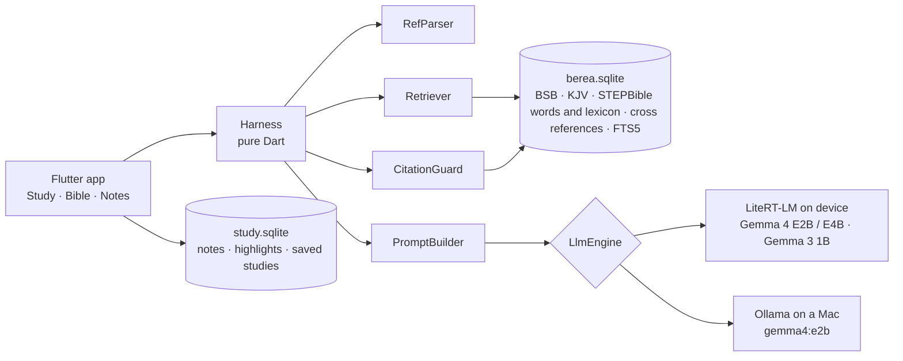

# Berea

A zero-data, fully offline, fully private study Bible and assistant. The language model runs on
your phone or laptop, the Bible lives in a local database, and every answer is checked against it
before you see it. Nothing is sent anywhere.

Named for Acts 17:11: the Bereans "received the message with great eagerness and examined the
Scriptures every day to see if these teachings were true."

Try it on Android: [download the latest APK](https://github.com/CalvinMagezi/berea/releases/latest).
How it works, in plain language: [calvinmagezi.github.io/berea](https://calvinmagezi.github.io/berea/).

<p align="center">
  
  
  
  
</p>
<p align="center">
  
  
  
  
</p>

## Principles

- **Zero data.** No account, no analytics, no crash reporting, no sync. The only network calls
  are the one-time model download you start yourself and, on a Mac, your own Ollama server.
- **Fully offline.** Scripture, lexicon, cross references and your notes are on the device.
- **Scripture first.** The model never quotes from memory. The harness retrieves verbatim text,
  the model reasons over it, and a validator flags anything the model invented. Grounding
  strength does not depend on model strength, so a 2 GB phone model stays honest.
- **Open.** MIT licensed app; public domain and CC BY data; models from the LiteRT community.

## What it does

**Study.** Ask about a passage, a word, or a question of life. Answers come with the Hebrew or
Greek behind the English, cross references, a contrast with worldly thinking and reflection
questions, in the voice of the "Bible Study Guide" prompt in `prompts/system.md`. Every cited
reference is verified against the local Bible and shown as a chip that opens the passage.
Unverified references or quotes are called out in red. Every study is saved and can be reopened.

**Bible.** An offline reader with the Berean Standard Bible, the King James Version and the World
English Bible built in. Search the whole Bible or type a reference to jump to it. Show a second
translation beside or below the text. Select verses to ask Berea about them, write a note, make a
study page or highlight them. Long-press a verse for its Hebrew or Greek words with
transliteration, gloss and lexicon entry. Import a translation you own (CSV, USFM, OSIS, Zefania
or a zip); it stays on your device.

**Plans.** Bible in a year, New Testament in 90 days, the Gospels in 30, Psalms and Proverbs in
60. Today's reading and a verse of the day sit on the Study tab.

**Study pages.** Observation, interpretation and application for a passage, drafted by Berea from
the retrieved Scripture, lexicon and cross references, then edited and kept by you.

**Notes.** Saved studies, study pages, notes and highlights in one searchable place. Export a study
or everything to Markdown.

**Backup.** One encrypted file (AES-256-GCM, key from your passphrase) that you keep wherever you
like. Restore checks the file before it replaces anything.

**Quick chat.** A chat button on every tab opens the same study.

## How it works



Each turn runs a fixed pipeline, not a free agent loop:

1. **RefParser** finds references in the question ("John 3:16", "Jn 3.16-18", "1 Cor 13",
   "II Timothy 3:16") and fetches those passages verbatim.
2. **Retriever** adds the tagged Hebrew or Greek words of the primary passage, the lexicon entries
   for their Strong's numbers, the top cross references by vote, and a stemmed FTS5 search over
   the whole Bible for the question's terms. A topical question with no reference follows the
   cross-reference graph from its search hits to the passages most of them point to.
3. **PromptBuilder** assembles a static system prompt (so the on-device prefix cache hits) and
   PASSAGES, LEXICON, WORDS, CROSS REFERENCES and RELATED VERSES blocks trimmed to the model tier's
   token budget, then the last two turns and the question.
4. **LlmEngine** streams the answer from LiteRT-LM or Ollama.
5. **CitationGuard** re-parses every reference in the answer and looks it up. Unknown chapters and
   verses, and citations of books that do not exist, become `[unverified: ...]`. A quoted phrase
   of 30+ characters that is not verbatim in any passage the model was shown is replaced with the
   exact words when one shown verse is clearly its source (`[quote corrected]`), and otherwise
   marked `[unverified quote]`.

### Model tiers

| Tier | Model | Prompt budget | Retrieval |
|------|-------|---------------|-----------|
| low | Gemma 3 1B | 2k tokens | 3 search hits, 4 cross refs, 6 lexicon entries |
| mid | Gemma 4 E2B (2.6 GB, default) | 4k | 6, 8, 12 |
| high | Gemma 4 E4B (4.3 GB), Ollama gemma4:e2b | 8k | 10, 12, 24 |

The tier follows the chosen model. Models download on first use from the Hugging Face
`litert-community` organisation; the catalog is in `lib/models.dart`. Gemma 4 E2B and E4B are not
gated. Gemma 3 1B needs a Hugging Face token after accepting its licence.

### Eval

```bash
cd packages/harness && dart run bin/eval.dart --tier mid --model gemma4:e2b
```

Runs 40 golden questions through the harness against Ollama, 8 of them adversarial (a chapter or
book that does not exist, Psalm 151, popular sayings that are not in the Bible), and reports
invented references, expected reference coverage, unverified quotes and misattributed sayings. A
release needs zero invented references and zero misattributions. Last run on gemma4:e2b, against
the official BSB text: 0 invented, 28 of 28 expected references, 0 misattributed, 8 of 8
adversarial.

`dart run bin/retrieval_check.dart` checks topical retrieval without a model: 7 of 8 topical
questions put a well-known passage on the topic in front of the model.

## Data

| Dataset | Licence | Role |
|---------|---------|------|
| Berean Standard Bible | Public domain (CC0) | Default translation, the official text from [bereanbible.com](https://bereanbible.com) (`bsb.txt`), pinned by SHA-256 |
| King James Version | Public domain | Second translation |
| World English Bible | Public domain | Third translation, from the ebible.org USFM |
| STEPBible TAHOT and TAGNT | CC BY 4.0 | Every Hebrew and Greek word with transliteration, gloss, Strong's number and morphology |
| STEPBible TBESH and TBESG | CC BY 4.0 | Hebrew and Greek lexicon keyed by Strong's |
| OpenBible.info cross references | CC BY | Cross references ranked by votes |

| STEPBible TFLSJ | CC BY 4.0 | Optional full Greek lexicon pack (about 9 MB), downloaded only on request from the [`lexicon-1` release](https://github.com/CalvinMagezi/berea/releases/tag/lexicon-1) and checked by SHA-256 |

`packages/harness/bin/build_db.dart` downloads these and writes `assets/berea.sqlite` (about 67 MB:
93k verses in three translations, 447k tagged words, 21k lexicon entries, 345k cross references,
366 daily verses) and a small `berea.sqlite.version` stamp. `bin/build_lexicon_pack.dart` builds
the optional lexicon pack, which is published with each release. None of these are committed.

The BSB is imported word for word from the official `bsb.txt`, and the build fails if its SHA-256 no
longer matches the pin in `build_db.dart`. When bereanbible.com publishes a revision, review the
new text, then update the pin. Each build also writes `.cache/bsb-diff.md`, a per-book count and
sample of verses that differ from the older scrollmapper copy that Berea 0.2 and earlier used.

Copyrighted translations such as the NIV and NLT are not bundled. Import one you own through the
engine settings from CSV (`Book,Chapter,Verse,Text`), USFM, OSIS, Zefania XML or a zip of those.
A normalised copy is kept under the app's support folder, re-imported after a database rebuild,
and never leaves the device.

User data (notes, highlights, saved studies, study pages and plan progress) lives in
`study.sqlite` next to the Bible database.

## Build and run

Requirements: Flutter 3.47+, Dart 3.13+. Xcode 27 for iOS and macOS, Android SDK for Android.

```bash
git clone https://github.com/CalvinMagezi/berea && cd berea
cd packages/harness && dart pub get && dart run bin/build_db.dart && cd ../..
flutter pub get
flutter run -d macos      # or -d <android device> / -d <ios simulator>
```

On a Mac the default engine is [Ollama](https://ollama.com) with `gemma4:e2b`
(`ollama pull gemma4:e2b`). On phones the default is on-device; open the engine settings and
download a model. Both can be switched in settings on any platform.

Command line harness without the app:

```bash
cd packages/harness && dart run bin/berea.dart --tier mid
```

Tests:

```bash
cd packages/harness && dart test && cd ../.. && flutter test
```

Release (builds the data, runs every check and the eval, builds Android and macOS, tags):

```bash
tool/release.sh 0.2.0
```

Android release signing reads `android/key.properties`; see `android/key.properties.example`.

## Project layout

```
lib/
  main.dart            boots the app
  home_shell.dart      Study, Bible and Notes tabs, quick chat sheet
  chat_screen.dart     streamed answers, citation chips, verse of the day, today's reading
  reader_screen.dart   offline reader, parallel text, selection bar, chapter picker
  search_screen.dart   full-text Bible search
  interlinear_sheet.dart  Hebrew and Greek words with lexicon entries
  study_page_screen.dart  observation, interpretation, application
  plans.dart, plans_screen.dart  reading plans
  notes_screen.dart    saved studies, study pages and notes
  export.dart          Markdown export
  backup.dart          encrypted backup and restore
  device.dart          device memory for the model recommendation
  app_state.dart       settings, engines, persistence, reader position
  edge_engine.dart     LiteRT-LM engine via flutter_edge_ai
  models.dart          on-device model catalog and recommendation
  study_store.dart     local SQLite for everything the user writes
  theme.dart           colour tokens, parchment and ink with a lamp-gold accent
packages/harness/
  lib/src/             RefParser, BibleDb, Retriever, PromptBuilder, CitationGuard, importers, engines
  bin/build_db.dart    builds assets/berea.sqlite from the datasets above
  bin/build_lexicon_pack.dart  builds the optional LSJ pack
  bin/berea.dart       CLI chat against Ollama
  bin/eval.dart        golden eval
  bin/retrieval_check.dart  topical retrieval check, no model needed
  bin/export_site.dart  writes the Bible data and parity fixture for the site's live check
  eval/golden.json     questions with expected references and adversarial bait
tool/release.sh        local release
tool/build_site.sh     builds the public site from site/ into build/site
site/                  the public page, deployed to GitHub Pages
  check/               a JavaScript copy of the reference check; selftest.mjs proves it matches
  vendor/scrollcraft/  scroll engine from nateherkai/scroll-craft (MIT)
prompts/system.md      the system prompt (grounding rules first, then the study guide)
prompts/gem-original.md the Gemini gem this started from
docs/screenshots/
```

## Platform notes

- **Android**: `minSdk 30`, arm64 only (LiteRT-LM). The emulator runs models on CPU.
- **iOS**: deployment target 15.0, CocoaPods only, extended-virtual-addressing and
  increased-memory-limit entitlements so a 2.6 GB model fits on a real iPhone. Swift Package
  Manager is turned off in `pubspec.yaml`: SPM debug builds embed an absolute host rpath, and when
  the checkout lives in a privacy-protected folder such as `~/Documents` the simulator's dyld hangs
  on it before `main` runs.
- **macOS**: the Podfile `post_install` stages the LiteRT-LM companion dylibs into the app so the
  on-device engine can load; Ollama is the default engine.
- **Windows and Linux**: built in CI. LiteRT-LM bundles its native libraries at build time; GPU on
  Linux needs a vendor Vulkan driver.
- A small method channel reports device memory so the settings can recommend a model.
- Debug builds read `BEREA_AUTORUN` or `autorun.txt` in the app's documents folder and run that
  question on launch, so a headless simulator or emulator can exercise the on-device path.

## Privacy

Berea makes no network request on its own. The model download goes to huggingface.co, and the
optional lexicon pack to github.com, only when you tap Download. The Ollama engine talks to the URL
you configure, `localhost` by default. There is no telemetry, no account, and no cloud copy of
anything you write. Backups are files you choose where to keep. Deleting the app deletes the
data.

Android cloud backup and device transfer are turned off, and the iOS data folder is excluded
from iCloud backup. That is deliberate, and it has a cost: a lost or reset phone loses your
notes unless you made a Berea backup file. Make one now and then (Engine settings, Back up) and
keep it somewhere you trust.

## Roadmap

Everything below keeps the core: zero data, fully offline, fully private.

- Real-device performance numbers for GPU backends on Android and iPhone.
- Keep one on-device conversation open across turns, if a real GPU phone shows a net win (the
  emulator did not; see `TECHDEBT.md`).
- On-device embeddings for semantic search, if the retrieval check falls short.
- Hebrew lexicon depth comparable to the optional Greek LSJ pack, when an openly licensed source
  exists.
- Store releases (TestFlight, Play) once signing keys are in place.

Open items with reasons are tracked in `TECHDEBT.md`. Changes are in `CHANGELOG.md`.

## Contributing

Issues and pull requests are welcome. Keep the principles: no network calls beyond the model
download and the user's own Ollama, no accounts, no analytics. Run the tests and, for anything that
touches the harness, the eval. Translations must be public domain or openly licensed to be bundled;
anything else stays an import.

## Licence

MIT. See `LICENSE`. Data licences are listed above; the STEPBible and OpenBible data require
attribution, which this README provides.
