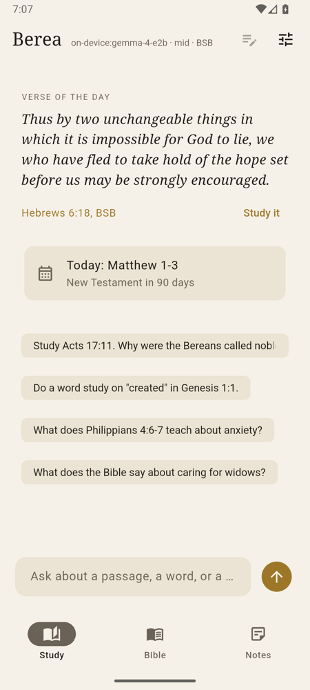
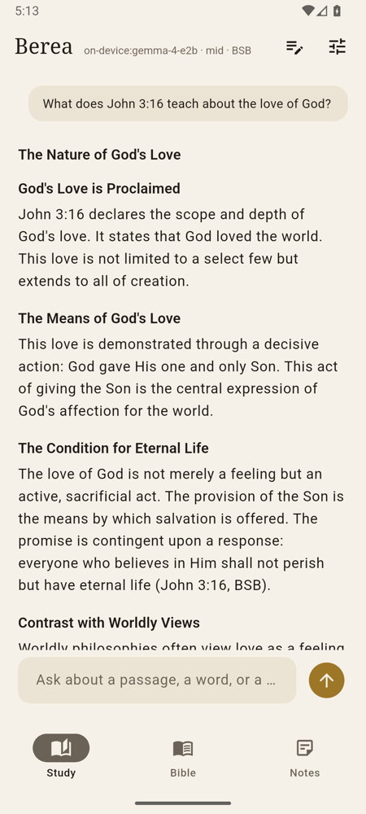
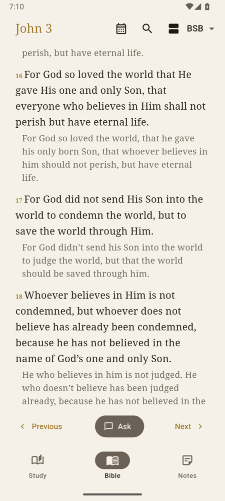
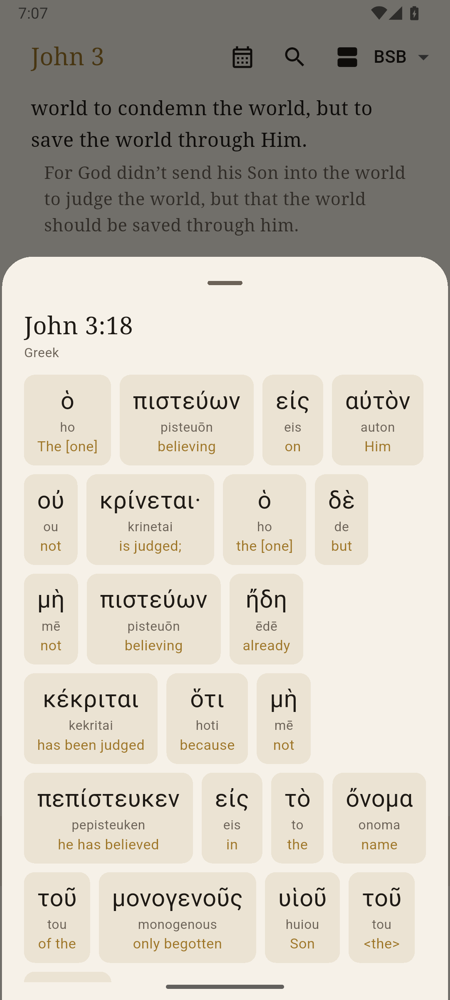
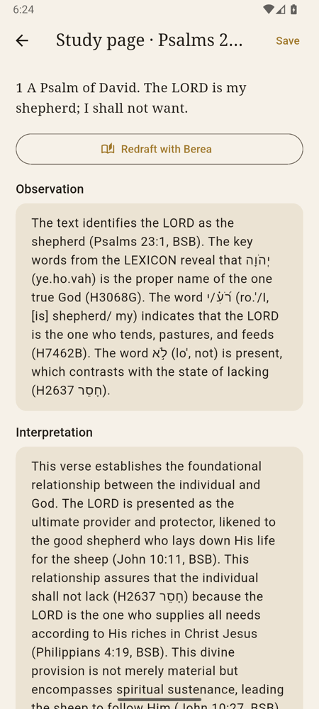
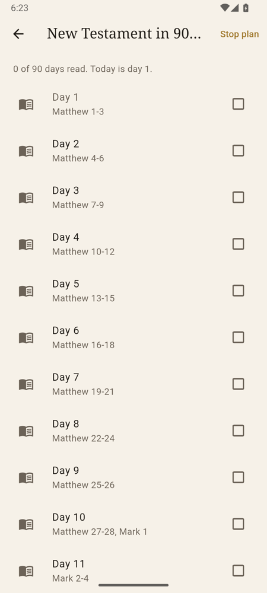
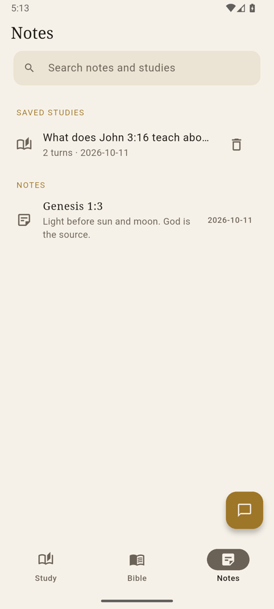
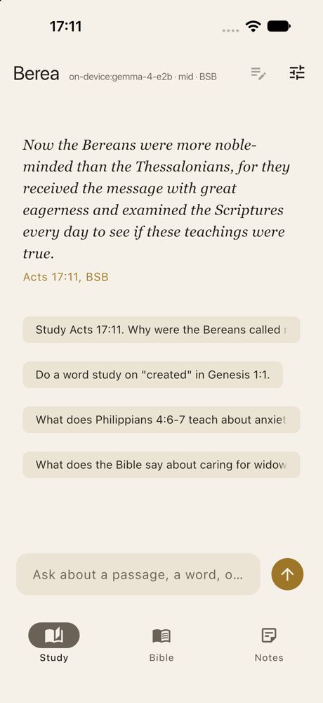
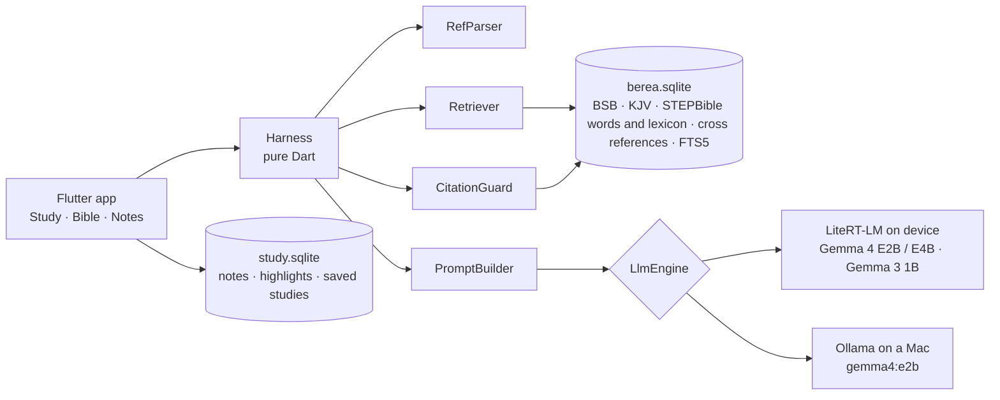

# Berea

A zero-data, fully offline, fully private study Bible and assistant. The language model runs on
your phone or laptop, the Bible lives in a local database, and every answer is checked against it
before you see it. Nothing is sent anywhere.

Named for Acts 17:11: the Bereans "received the message with great eagerness and examined the
Scriptures every day to see if these teachings were true."

Try it: [Android APK](https://github.com/CalvinMagezi/berea/releases/latest/download/berea-android-arm64.apk)
or [Mac app](https://github.com/CalvinMagezi/berea/releases/latest/download/berea-macos.zip)
(not notarized yet: the first time, open it from System Settings, Privacy & Security, Open Anyway).
On a Mac, Berea answers with [Ollama](https://ollama.com) (`ollama pull gemma4:e2b`) or a model it downloads.
How it works, in plain language: [calvinmagezi.github.io/berea](https://calvinmagezi.github.io/berea/).

<p align="center">
  
  
  
  
</p>
<p align="center">
  
  
  
  
</p>

## Principles

- **Zero data.** No account, no analytics, no crash reporting, no sync. The only network calls
  are the one-time model download you start yourself and, on a Mac, your own Ollama server.
- **Fully offline.** Scripture, lexicon, cross references and your notes are on the device.
- **Scripture first.** The model never quotes from memory. The harness retrieves verbatim text,
  the model reasons over it, and a validator flags anything the model invented. Grounding
  strength does not depend on model strength, so a 2 GB phone model stays honest.
- **Open.** MIT licensed app; public domain and CC BY data; models from the LiteRT community.

## What it does

**Study.** Ask about a passage, a word, or a question of life. Answers come with the Hebrew or
Greek behind the English, cross references, a contrast with worldly thinking and reflection
questions, in the voice of the "Bible Study Guide" prompt in `prompts/system.md`. Every cited
reference is verified against the local Bible and shown as a chip that opens the passage.
Unverified references or quotes are called out in red. Every study is saved and can be reopened.
With Gemma 4 on the device you can also ask by voice: hold the microphone (or tap to start and
stop) and speak for up to 30 seconds. Gemma 4 hears it directly, with no separate speech model,
and types the question into the box for you to check before it is sent.

**Commentary.** Select verses and tap Commentary for what Matthew Henry, Jamieson, Fausset and
Brown, the Treasury of Scripture Knowledge, Aquinas's Catena Aurea and, if you add them, Calvin,
Clarke, Keil and Delitzsch, Barnes, Wesley and Spurgeon say on them, each with its author and
licence. The packs are optional public domain downloads.

**Bible.** An offline reader with the Berean Standard Bible, the King James Version and the World
English Bible built in. Search the whole Bible or type a reference to jump to it. Show a second
translation beside or below the text. Select verses to ask Berea about them, write a note, make a
study page or highlight them. Long-press a verse for its Hebrew or Greek words with
transliteration, gloss and lexicon entry. Import a translation you own (CSV, USFM, OSIS, Zefania
or a zip); it stays on your device.

**Plans.** Bible in a year, New Testament in 90 days, the Gospels in 30, Psalms and Proverbs in
60. Today's reading and a verse of the day sit on the Study tab.

**Study pages.** Observation, interpretation and application for a passage, drafted by Berea from
the retrieved Scripture, lexicon and cross references, then edited and kept by you.

**Notes.** Saved studies, study pages, notes and highlights in one searchable place. Export a study
or everything to Markdown.

**Notebooks.** Gather what you read on one passage or topic: Bible passages, commentary from the
installed packs, your notes, pasted text, PDFs and EPUB books. Berea reads each source on the
device, splits it into sections that remember where they came from (and the PDF page), and
indexes them for search. A source is a copy taken when you add it, so editing a note later does
not change the notebook.

**Notebook chat.** Ask inside a notebook and the answer draws on its sources as well as
Scripture. Each source is cited by a tag: `[S3 p.14]` for page 14 of a PDF, `[S3 §2]` for the
second section of anything else, `[C4821]` for commentary from an installed pack (a number fixed
by the passage, so it means the same in every answer). Tap the chip under
the answer to open the source at that section. Pin a source to offer it to every answer. Each
notebook keeps one conversation, saved with it and included in backups.

**Backup.** One encrypted file (AES-256-GCM, key from your passphrase) that you keep wherever you
like. Restore checks the file before it replaces anything.

**Quick chat.** A chat button on every tab opens the same study.

## How it works



Each turn runs a fixed pipeline, not a free agent loop:

1. **RefParser** finds references in the question ("John 3:16", "Jn 3.16-18", "1 Cor 13",
   "II Timothy 3:16") and fetches those passages verbatim.
2. **Retriever** adds the tagged Hebrew or Greek words of the primary passage, the lexicon entries
   for their Strong's numbers, the top cross references by vote, and a stemmed FTS5 search over
   the whole Bible for the question's terms. A topical question with no reference follows the
   cross-reference graph from its search hits to the passages most of them point to.
3. **PromptBuilder** assembles a static system prompt (so the on-device prefix cache hits) and
   PASSAGES, LEXICON, WORDS, CROSS REFERENCES and RELATED VERSES blocks trimmed to the model tier's
   token budget, then the last two turns and the question. It returns what it actually kept, and
   only that counts as shown in step 5. In a notebook, notebook rules join the system prompt and a
   SOURCES block follows PASSAGES with its own share of the budget: sections of pinned sources,
   search hits across the notebook, commentary from installed packs on the passages in view, then
   the start of every source.
4. **LlmEngine** streams the answer from LiteRT-LM or Ollama.
5. **CitationGuard** re-parses every reference in the answer and looks it up. Unknown chapters and
   verses, and citations of books that do not exist, become `[unverified: ...]`. A quoted phrase
   of 30+ characters that is not verbatim in any passage the model was shown is replaced with the
   exact words when one shown verse is clearly its source (`[quote corrected]`), and otherwise
   marked `[unverified quote]`. Quotes in any script are compared, not only English. In a
   notebook it also checks every source tag in brackets or parentheses: a source, page or
   section that was not shown, or anything in square brackets that means a source but is not a
   tag (`[Source 9]`, `[S3 and S9]`), becomes `unverified source: ...`. A quote followed by a source tag must be
   in that source's shown text; a quote attributed to a verse must be in the verses. A quote a
   source supports but that reads as a shown verse reworded is marked
   `[differs from Scripture]`, so a source that misquotes Scripture can never vouch for the
   misquote.

### Model tiers

| Tier | Model | Prompt budget | Retrieval |
|------|-------|---------------|-----------|
| low | Gemma 3 1B | 2k tokens | 3 search hits, 4 cross refs, 6 lexicon entries |
| mid | Gemma 4 E2B (2.6 GB, default) | 4k | 6, 8, 12 |
| high | Gemma 4 E4B (4.3 GB), Ollama gemma4:e2b | 8k | 10, 12, 24 |

Notebook answers give SOURCES up to 700, 1,400 or 3,000 of those tokens. The engine opens with
the prompt budget plus the answer plus 512 tokens of padding: windows of 3,112, 5,412 and 9,912
tokens. Budgets use a deliberately high estimate (four letters to a token, but one token for
every digit, punctuation mark and Hebrew or Greek character), because Gemma's tokenizer splits
those finely: the old characters / 4 estimate let real mid and high prompts reach 5,343 and 14,417
tokens, past their windows. `dart run bin/prompt_size.dart` measures real prompts with Ollama;
the worst Study or notebook prompt plus the full answer now comes to 2,441, 4,531 and 8,530
tokens, inside each window.

The tier follows the chosen model, except that a phone under 7 GB starts Gemma 4 E2B at the low
tier. Models download on first use; the catalog is in `lib/models.dart`. Gemma 4 E2B and E4B come
from the Hugging Face `litert-community` organisation and are not gated. Gemma 3 1B is gated
there, so Berea hosts the unmodified file on its own GitHub release (`model-gemma3-1b-1`), checks
it against a pinned SHA-256 and needs no account or token. It stays under the Gemma Terms of Use
and Prohibited Use Policy, shown before the download and under Licences and sources.

### Eval

```bash
cd packages/harness && dart run bin/eval.dart --tier mid --model gemma4:e2b
```

Runs 40 golden questions through the harness against Ollama, 8 of them adversarial (a chapter or
book that does not exist, Psalm 151, popular sayings that are not in the Bible), and reports
invented references, expected reference coverage, unverified quotes and misattributed sayings. A
release needs zero invented references and zero misattributions. Last run on gemma4:e2b, against
the official BSB text: 0 invented, 28 of 28 expected references, 0 misattributed, 8 of 8
adversarial.

`--brief` runs the same questions with the brief answer rule that Study uses at the low tier. On
gemma4:e2b through Ollama at that tier, two full runs and one brief run (0.3 temperature, so each
varies a little): full answers averaged 253 words in 119 to 147 s, with 2 unverified quotes and 1
misattributed saying both times; brief answers averaged 45 words in 51 s, with 0 invented, 28 of
28 expected references, 0 unverified quotes, 0 misattributed and 8 of 8 adversarial.

`dart run bin/eval.dart --tier mid --notebook` runs 10 questions against a notebook built in code
(pasted sermon notes, Acts 17:10-12, a three-page guide and a friend's note that misquotes John
3:16), 4 of them adversarial: a topic the sources do not cover, the misquote, and a page and a
section that do not exist. It reports invented references, invented source citations, expected
verse and source citations, unverified quotes and misattributions; zero invented source
citations is a release gate alongside zero invented references. `--commentary <pack>` adds an
installed commentary pack and `--show` prints each answer. Last run on gemma4:e2b: 0 invented
references, 0 invented source citations, 3 of 3 verses and 5 of 5 sources cited, 0
misattributed, 4 of 4 adversarial.

`dart run bin/retrieval_check.dart` checks topical retrieval without a model: 7 of 8 topical
questions put a well-known passage on the topic in front of the model.

## Data

| Dataset | Licence | Role |
|---------|---------|------|
| Berean Standard Bible | Public domain (CC0) | Default translation, the official text from [bereanbible.com](https://bereanbible.com) (`bsb.txt`), pinned by SHA-256 |
| King James Version | Public domain | Second translation |
| World English Bible | Public domain | Third translation, from the ebible.org USFM |
| STEPBible TAHOT and TAGNT | CC BY 4.0 | Every Hebrew and Greek word with transliteration, gloss, Strong's number and morphology |
| STEPBible TBESH and TBESG | CC BY 4.0 | Hebrew and Greek lexicon keyed by Strong's |
| OpenBible.info cross references | CC BY | Cross references ranked by votes |

| STEPBible TFLSJ | CC BY 4.0 | Optional full Greek lexicon pack (about 9 MB), downloaded only on request from the [`lexicon-1` release](https://github.com/CalvinMagezi/berea/releases/tag/lexicon-1) and checked by SHA-256 |

Optional commentary packs, each downloaded only on request from the
[`commentary-1` release](https://github.com/CalvinMagezi/berea/releases/tag/commentary-1),
checked by SHA-256 and kept on the device. All come from CrossWire SWORD modules whose
`DistributionLicense` is `Public Domain`; the converter refuses any other licence.

| Pack (download) | Commentary | Licence note |
|-----------------|------------|--------------|
| Core (19 MB) | Matthew Henry's Concise Commentary (MHCC 2.0) | Public domain (Henry, 1706-1721) |
| | Jamieson, Fausset and Brown (JFB 3.0) | Public domain (1871) |
| | The Treasury of Scripture Knowledge (TSK 1.4) | Public domain (Torrey, 1880s) |
| | Catena Aurea on the Gospels (Catena 1.0.1) | Public domain (Aquinas, tr. Newman 1842); OSIS by Tom Lemmens, [lemtom/catena](https://github.com/lemtom/catena), CC0 |
| Matthew Henry, complete (24 MB) | MHC 2.2 | Public domain |
| Adam Clarke (15 MB) | Clarke 2.0 | Public domain (1810-1826) |
| John Calvin (25 MB) | CalvinCommentaries 1.1 | Public domain (Calvin Translation Society, 1844-1856) |
| Keil and Delitzsch, OT (17 MB) | KD 2.0 | Public domain (English translation 1866-1891) |
| Albert Barnes, NT (10 MB) | Barnes 1.1 | Public domain (1832-1851) |
| John Wesley (4 MB) | Wesley 1.1 | Public domain (1755-1765) |
| Spurgeon, The Treasury of David (8 MB) | TDavid 2.1 | Public domain (1869-1885) |

Not included: Robertson's Word Pictures and KingComments (non-commercial licences), anything
from Bible Hub or StudyLight, and John Gill (the HelloAO copy is marked Public Domain but its
provenance is undocumented, and it was not reachable when the packs were built). Patristic
excerpts from HistoricalChristianFaith/Commentaries-Database are mixed-licence and not yet
included; see `TECHDEBT.md`. The app lists every source and licence under Settings,
Commentaries, Licences and sources.

`packages/harness/bin/build_db.dart` downloads these and writes `assets/berea.sqlite` (about 67 MB:
93k verses in three translations, 447k tagged words, 21k lexicon entries, 345k cross references,
366 daily verses) and a small `berea.sqlite.version` stamp. `bin/build_lexicon_pack.dart` builds
the optional lexicon pack, which is published with each release. None of these are committed.

The BSB is imported word for word from the official `bsb.txt`, and the build fails if its SHA-256 no
longer matches the pin in `build_db.dart`. When bereanbible.com publishes a revision, review the
new text, then update the pin. Each build also tries to write `.cache/bsb-diff.md`, a per-book
count and sample of verses that differ from the older scrollmapper copy that Berea 0.2 and earlier
used. The report is best effort: if that older copy cannot be fetched or fails its pin, the build
warns, writes no report and carries on.

`bin/build_commentary.dart` builds the commentary packs into `build/commentary/` with a
`manifest.json` of sizes, entry counts and SHA-256 pins. It reads the SWORD zCom files with a
small pure Dart reader (`lib/src/sword.dart`); libsword and pysword (both GPL) are not used at
build time or linked into the app. It needs `assets/berea.sqlite` for KJV versification, which
is what every SWORD module here is keyed to. Each CrossWire module zip is pinned by SHA-256, so a
republished module stops the build until it is reviewed, and a module whose `.conf` is not
Public Domain, KJV-keyed zCom is refused. Each pack is SQLite with
`entries(module, book, chapter, verse_start, verse_end, html_or_text)` holding plain display
text, an FTS5 index (porter unicode61), the module's attribution and a format stamp; the same
sources always give the same bytes. Book and chapter introductions are stored with chapter 0 or
verse 0; Matthew Henry's section-start keys are expanded to ranges, and Calvin's title pages and
prefaces (kept at Genesis 1:1, Psalm 1:1 and the first verse of other books) and the book
prefaces and chapter outlines that Keil and Delitzsch, Clarke and Barnes keep before their
first verse heading become introductions instead of verse comments. Spurgeon's Treasury of
David, which holds a whole psalm at its first verse, is split at its "Verse N" paragraphs. After a build, publish the `.gz` files
to the `commentary-1` release and copy the pins from `manifest.json` into `lib/commentary_packs.dart`.

Copyrighted translations such as the NIV and NLT are not bundled. Import one you own through the
engine settings from CSV (`Book,Chapter,Verse,Text`), USFM, OSIS, Zefania XML or a zip of those.
A normalised copy is kept under the app's support folder, re-imported after a database rebuild,
and never leaves the device.

User data (notes, highlights, saved studies, study pages, plan progress and notebooks) lives in
`study.sqlite` next to the Bible database. Notebook tables (`notebooks`, `notebook_sources` with
the normalised text, `notebook_chunks` with character offsets and PDF page numbers, and the
`notebook_chunks_fts` index kept in step by triggers) are added by a `user_version` migration,
and backups carry them from version 2 on.

PDF text is read with [PDFium](https://pdfium.googlesource.com/pdfium/) through
`pdfium_flutter` and `pdfium_dart` (MIT). PDFium is BSD 3-Clause and Apache 2.0; the binaries
also carry FreeType (FreeType License), libjpeg-turbo, OpenJPEG, Little CMS, libpng, zlib,
Abseil and ICU under their own permissive licences. Their full texts are kept in
`licenses/pdfium/` and shown on the app's licence page (Settings, Commentaries, Licences and
sources, Software licences). On iOS the pod fetches a PDFium build pinned by SHA-256. On
Android, Windows, Linux and macOS the package's build hook downloads `bblanchon/pdfium-binaries`
`chromium/7811` without a hash check unless the file is already in place, so run
`tool/pin_pdfium.sh <target>` (for example `mac-arm64`) after `flutter pub get` to put SHA-256
checked copies there first; CI and `tool/release.sh` do. On macOS both are built and land in the same
case-insensitive Frameworks folder, so which copy ships depends on build order (see
`TECHDEBT.md`). The app itself never downloads PDFium. EPUB is read with the harness's own zip reader and a
small XHTML to text step.

## Build and run

Requirements: Flutter 3.47+, Dart 3.13+. Xcode 27 for iOS and macOS, Android SDK for Android.

```bash
git clone https://github.com/CalvinMagezi/berea && cd berea
cd packages/harness && dart pub get && dart run bin/build_db.dart && cd ../..
flutter pub get
tool/pin_pdfium.sh mac-arm64   # SHA-256 checked PDFium for this Mac (see Data)
flutter run -d macos      # or -d <android device> / -d <ios simulator>
```

On a Mac the default engine is [Ollama](https://ollama.com) with `gemma4:e2b`
(`ollama pull gemma4:e2b`). On phones the default is on-device; open the engine settings and
download a model. Both can be switched in settings on any platform.

Command line harness without the app:

```bash
cd packages/harness && dart run bin/berea.dart --tier mid
```

Tests:

```bash
cd packages/harness && dart test && cd ../.. && flutter test
flutter test integration_test -d macos   # notebooks smoke test, real app, throwaway data folder
```

Release (builds the data, runs every check and the eval, builds Android and macOS, tags):

```bash
tool/release.sh 0.3.0
```

Android release signing reads `android/key.properties`; see `android/key.properties.example`.
Each app release also carries the APK as `berea-android-arm64.apk` and the Mac app as
`berea-macos.zip`, which links through `releases/latest/download/` always find, so publish app
releases with `--latest` and data releases (such as
`lexicon-1` and `commentary-1`) with `--latest=false`.

## Project layout

```
lib/
  main.dart            boots the app
  home_shell.dart      Study, Bible, Notes and Notebooks tabs, quick chat sheet
  chat_screen.dart     streamed answers, citation chips, verse of the day, today's reading
  voice.dart, voice_composer.dart  hold-to-talk recording, Gemma 4 transcription, mic button
  reader_screen.dart   offline reader, parallel text, selection bar, chapter picker
  search_screen.dart   full-text Bible search
  interlinear_sheet.dart  Hebrew and Greek words with lexicon entries
  commentary_sheet.dart   commentary on the selected verses, with attribution
  commentary_packs.dart   optional commentary packs: pins, download, install, delete
  commentary_settings.dart, attributions_screen.dart  pack settings, licences and sources
  pinned_download.dart    streamed download checked against a published SHA-256
  study_page_screen.dart  observation, interpretation, application
  plans.dart, plans_screen.dart  reading plans
  notes_screen.dart    saved studies, study pages and notes
  notebooks_screen.dart  notebooks, their sources, pins, add-source flows and the source reader
  notebook_store.dart  notebook tables, background ingestion, search, pins and conversations
  notebook_chat.dart, notebook_chat_screen.dart  a notebook's conversation and its screen
  pdf_text.dart        PDF page text through PDFium
  export.dart          Markdown export
  backup.dart          encrypted backup and restore
  device.dart          device memory for the model recommendation
  app_state.dart       settings, engines, persistence, reader position
  edge_engine.dart     LiteRT-LM engine via flutter_edge_ai
  models.dart          on-device model catalog and recommendation
  study_store.dart     local SQLite for everything the user writes
  theme.dart           colour tokens, parchment and ink with a lamp-gold accent
packages/harness/
  lib/src/             RefParser, BibleDb, Retriever, PromptBuilder, CitationGuard, importers, engines,
                       notebook chunking, EPUB and HTML text, notebook retrieval and source tags
  bin/build_db.dart    builds assets/berea.sqlite from the datasets above
  bin/build_lexicon_pack.dart  builds the optional LSJ pack
  bin/build_commentary.dart  builds the optional commentary packs from SWORD modules
  bin/berea.dart       CLI chat against Ollama
  bin/eval.dart        golden eval; --notebook runs the notebook cases on bin/notebook_fixture.dart
  bin/retrieval_check.dart  topical retrieval check, no model needed
  bin/prompt_size.dart real prompt sizes per tier, measured by Ollama against each window
  bin/export_site.dart  writes the Bible data and parity fixture for the site's live check
  eval/golden.json     questions with expected references and adversarial bait
  eval/notebook.json   notebook questions with expected verses and sources
tool/release.sh        local release
tool/build_site.sh     builds the public site from site/ into build/site
tool/audio/            build-time word timings and audio packs for the CC0 narration (Python)
site/                  the public page, deployed to GitHub Pages
  check/               a JavaScript copy of the reference check; selftest.mjs proves it matches
  vendor/scrollcraft/  scroll engine from nateherkai/scroll-craft (MIT)
prompts/system.md      the system prompt (grounding rules first, then the study guide)
prompts/gem-original.md the Gemini gem this started from
docs/screenshots/
```

## Platform notes

- **Android**: `minSdk 30`, arm64 only (LiteRT-LM). Answers run on the CPU on every platform:
  GPU decode corrupts digits on some phones (LiteRT-LM #2202), and verse numbers are digits.
- **iOS**: deployment target 15.0, CocoaPods only, extended-virtual-addressing and
  increased-memory-limit entitlements so a 2.6 GB model fits on a real iPhone. Swift Package
  Manager is turned off in `pubspec.yaml`: SPM debug builds embed an absolute host rpath, and when
  the checkout lives in a privacy-protected folder such as `~/Documents` the simulator's dyld hangs
  on it before `main` runs.
- **macOS**: the Podfile `post_install` stages the LiteRT-LM companion dylibs into the app so the
  on-device engine can load; Ollama is the default engine.
- **Windows and Linux**: built in CI. LiteRT-LM bundles its native libraries at build time. Answers
  run on the CPU here too, so no GPU driver is needed.
- **Voice**: the `record` package (BSD-3-Clause) records 16 kHz mono 16-bit WAV, the format
  Gemma 4 reads through flutter_edge_ai's audio input (`supportAudio` on the model and the chat).
  Gemma 4 models load with the audio encoder, which also runs on the CPU; if it fails to load,
  the model loads text only and voice is turned off. Android declares
  `RECORD_AUDIO`; iOS and macOS carry `NSMicrophoneUsageDescription`, and both macOS entitlement
  files carry `com.apple.security.device.audio-input`. On Linux, voice needs `parecord`
  (PulseAudio or PipeWire) and `ffmpeg` installed. Recordings go in a private folder in the app's
  cache and are deleted as soon as they are read.
- A small method channel reports device memory so the settings can recommend a model.
- Debug builds read `BEREA_AUTORUN` or `autorun.txt` in the app's documents folder and run that
  question on launch, so a headless simulator or emulator can exercise the on-device path.

## Privacy

Berea makes no network request on its own. The Gemma 4 model download goes to huggingface.co, and the
Gemma 3 1B model, the optional lexicon and the commentary packs to github.com, only when you tap Download. The Ollama engine talks to the URL
you configure, `localhost` by default; a notebook question sends that server the sections of your
sources the answer draws on, so point it only at a machine you trust. A voice question is recorded
to a temporary file on the device, read into memory and deleted before Gemma 4 transcribes it; it
is never stored or sent. There is no telemetry, no account, and no cloud copy of
anything you write. Backups are files you choose where to keep. Deleting the app deletes the
data.

Android cloud backup and device transfer are turned off, and the iOS data folder is excluded
from iCloud backup. That is deliberate, and it has a cost: a lost or reset phone loses your
notes unless you made a Berea backup file. Make one now and then (Engine settings, Back up) and
keep it somewhere you trust.

## Roadmap

Everything below keeps the core: zero data, fully offline, fully private.

- GPU answers again once a real Mali phone shows LiteRT-LM #2202 fixed (see `TECHDEBT.md`), with
  real-device performance numbers for Android and iPhone.
- Keep one on-device conversation open across turns, if a real GPU phone shows a net win (the
  emulator did not; see `TECHDEBT.md`).
- On-device embeddings for semantic search, if the retrieval check falls short.
- Hebrew lexicon depth comparable to the optional Greek LSJ pack, when an openly licensed source
  exists.
- Store releases (TestFlight, Play) once signing keys are in place.

Open items with reasons are tracked in `TECHDEBT.md`. Changes are in `CHANGELOG.md`.

## Contributing

Issues and pull requests are welcome. Keep the principles: no network calls beyond the model
download and the user's own Ollama, no accounts, no analytics. Run the tests and, for anything that
touches the harness, the eval. Translations must be public domain or openly licensed to be bundled;
anything else stays an import.

## Licence

MIT. See `LICENSE`. Data licences are listed above; the STEPBible and OpenBible data require
attribution, which this README provides.
