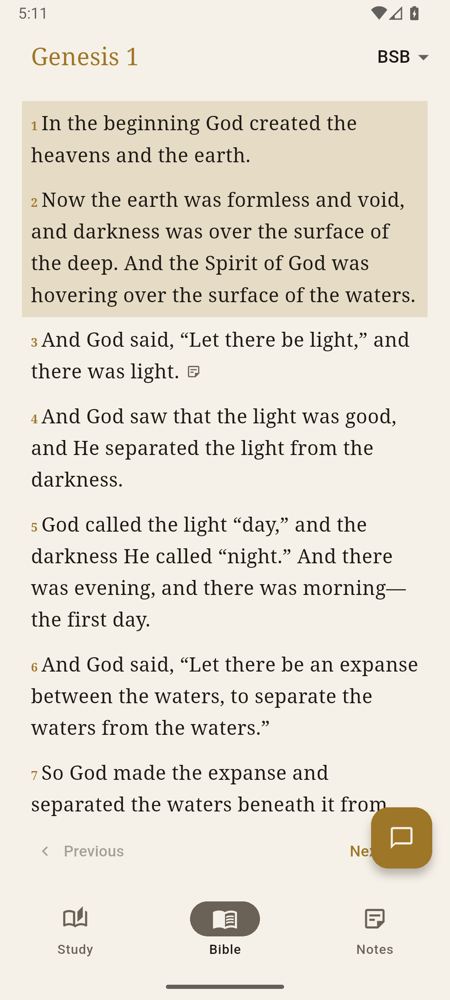
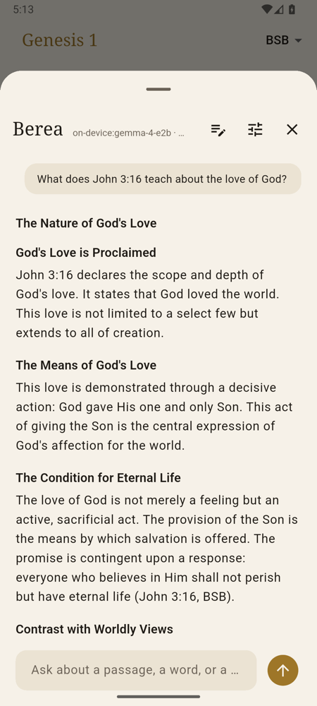
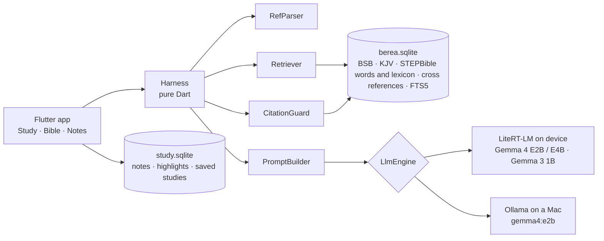

# Berea

A zero-data, fully offline, fully private study Bible and assistant. The language model runs on
your phone or laptop, the Bible lives in a local database, and every answer is checked against it
before you see it. Nothing is sent anywhere.

Named for Acts 17:11: the Bereans "received the message with great eagerness and examined the
Scriptures every day to see if these teachings were true."

<p align="center">
  
  
  
  
  
</p>

## Principles

- **Zero data.** No account, no analytics, no crash reporting, no sync. The only network calls
  are the one-time model download you start yourself and, on a Mac, your own Ollama server.
- **Fully offline.** Scripture, lexicon, cross references and your notes are on the device.
- **Scripture first.** The model never quotes from memory. The harness retrieves verbatim text,
  the model reasons over it, and a validator flags anything the model invented. Grounding
  strength does not depend on model strength, so a 2 GB phone model stays honest.
- **Open.** MIT licensed app; public domain and CC BY data; models from the LiteRT community.

## What it does

**Study.** Ask about a passage, a word, or a question of life. Answers come with the Hebrew or
Greek behind the English, cross references, a contrast with worldly thinking and reflection
questions, in the voice of the "Bible Study Guide" prompt in `prompts/system.md`. Every cited
reference is verified against the local Bible and shown as a chip that opens the passage.
Unverified references or quotes are called out in red. Every study is saved and can be reopened.

**Bible.** An offline reader with the Berean Standard Bible and the King James Version built in.
Pick any book and chapter, switch translation, select verses to ask Berea about them, add a note
or highlight them. Import a translation you own as a CSV; it stays on your device.

**Notes.** Saved studies, notes and highlights in one searchable place.

**Quick chat.** A chat button on every tab opens the same study in a sheet.

## How it works



Each turn runs a fixed pipeline, not a free agent loop:

1. **RefParser** finds references in the question ("John 3:16", "Jn 3.16-18", "1 Cor 13",
   "II Timothy 3:16") and fetches those passages verbatim.
2. **Retriever** adds the tagged Hebrew or Greek words of the primary passage, the lexicon entries
   for their Strong's numbers, the top cross references by vote, and an FTS5 search over the
   whole Bible for the question's terms.
3. **PromptBuilder** assembles a static system prompt (so the on-device prefix cache hits) and
   PASSAGES, LEXICON, WORDS, CROSS REFERENCES and RELATED VERSES blocks trimmed to the model tier's
   token budget, then the last two turns and the question.
4. **LlmEngine** streams the answer from LiteRT-LM or Ollama.
5. **CitationGuard** re-parses every reference in the answer and looks it up. Unknown references
   become `[unverified: ...]`. Quoted phrases of 30+ characters that do not appear verbatim in any
   passage the model was shown are marked `[unverified quote]`.

### Model tiers

| Tier | Model | Prompt budget | Retrieval |
|------|-------|---------------|-----------|
| low | Gemma 3 1B | 2k tokens | 3 search hits, 4 cross refs, 6 lexicon entries |
| mid | Gemma 4 E2B (2.6 GB, default) | 4k | 6, 8, 12 |
| high | Gemma 4 E4B (4.3 GB), Ollama gemma4:e2b | 8k | 10, 12, 24 |

The tier follows the chosen model. Models download on first use from the Hugging Face
`litert-community` organisation; the catalog is in `lib/models.dart`. Gemma 4 E2B and E4B are not
gated. Gemma 3 1B needs a Hugging Face token after accepting its licence.

### Eval

```bash
cd packages/harness && dart run bin/eval.dart --tier mid --model gemma4:e2b
```

Runs 25 golden questions through the harness against Ollama and reports invented references,
expected reference coverage and unverified quotes. A release needs zero invented references.
Last run on gemma4:e2b: 0 invented, 21 of 21 expected references covered, 2 flagged quotes
(paraphrases).

## Data

| Dataset | Licence | Role |
|---------|---------|------|
| Berean Standard Bible | Public domain (CC0) | Default translation |
| King James Version | Public domain | Second translation |
| STEPBible TAHOT and TAGNT | CC BY 4.0 | Every Hebrew and Greek word with transliteration, gloss, Strong's number and morphology |
| STEPBible TBESH and TBESG | CC BY 4.0 | Hebrew and Greek lexicon keyed by Strong's |
| OpenBible.info cross references | CC BY | Cross references ranked by votes |

`packages/harness/bin/build_db.dart` downloads these and writes `assets/berea.sqlite` (about 60 MB:
62k verses, 447k tagged words, 21k lexicon entries, 345k cross references). The file is built,
not committed.

Copyrighted translations such as the NIV and NLT are not bundled. Import one you own from a
`Book,Chapter,Verse,Text` CSV through the engine settings. The copy is kept under the app's
support folder, re-imported after a database rebuild, and never leaves the device.

User data lives in `study.sqlite` next to the Bible database.

## Build and run

Requirements: Flutter 3.47+, Dart 3.13+. Xcode 27 for iOS and macOS, Android SDK for Android.

```bash
git clone https://github.com/CalvinMagezi/berea && cd berea
cd packages/harness && dart pub get && dart run bin/build_db.dart && cd ../..
flutter pub get
flutter run -d macos      # or -d <android device> / -d <ios simulator>
```

On a Mac the default engine is [Ollama](https://ollama.com) with `gemma4:e2b`
(`ollama pull gemma4:e2b`). On phones the default is on-device; open the engine settings and
download a model. Both can be switched in settings on any platform.

Command line harness without the app:

```bash
cd packages/harness && dart run bin/berea.dart --tier mid
```

Tests:

```bash
cd packages/harness && dart test && cd ../.. && flutter test
```

## Project layout

```
lib/
  main.dart            boots the app
  home_shell.dart      Study, Bible and Notes tabs, quick chat sheet
  chat_screen.dart     streamed answers, citation chips, engine notice
  reader_screen.dart   offline reader, selection bar, chapter picker
  notes_screen.dart    saved studies and notes
  app_state.dart       settings, engines, study persistence, reader position
  edge_engine.dart     LiteRT-LM engine via flutter_edge_ai
  models.dart          on-device model catalog
  study_store.dart     local SQLite for notes, highlights and saved studies
  theme.dart           colour tokens, parchment and ink with a lamp-gold accent
packages/harness/
  lib/src/             RefParser, BibleDb, Retriever, PromptBuilder, CitationGuard, engines
  bin/build_db.dart    builds assets/berea.sqlite from the datasets above
  bin/berea.dart       CLI chat against Ollama
  bin/eval.dart        golden eval
  eval/golden.json     questions with expected references
prompts/system.md      the system prompt (grounding rules first, then the study guide)
prompts/gem-original.md the Gemini gem this started from
docs/screenshots/
```

## Platform notes

- **Android**: `minSdk 30`, arm64 only (LiteRT-LM). The emulator runs models on CPU.
- **iOS**: deployment target 15.0, CocoaPods only, extended-virtual-addressing and
  increased-memory-limit entitlements so a 2.6 GB model fits on a real iPhone. Swift Package
  Manager is turned off in `pubspec.yaml`: SPM debug builds embed an absolute host rpath, and when
  the checkout lives in a privacy-protected folder such as `~/Documents` the simulator's dyld hangs
  on it before `main` runs.
- **macOS**: the Podfile `post_install` stages the LiteRT-LM companion dylibs into the app so the
  on-device engine can load; Ollama is the default engine.
- Debug builds read `BEREA_AUTORUN` or `autorun.txt` in the app's documents folder and run that
  question on launch, so a headless simulator or emulator can exercise the on-device path.

## Privacy

Berea makes no network request on its own. The model download goes to huggingface.co when you tap
Download. The Ollama engine talks to the URL you configure, `localhost` by default. There is no
telemetry, no account, and no cloud copy of anything you write. Deleting the app deletes the data.

## Roadmap

Everything below keeps the core: zero data, fully offline, fully private.

- **Grounding**: replace flagged quotes with the verbatim verse instead of marking them; one
  optional tool round for strong models (`lookup_passage`, `search_bible`, `search_lexicon`);
  keep one LiteRT-LM conversation open across turns so the system prompt is prefilled once.
- **Reader**: search the Bible from the Bible tab (the FTS5 index already exists); parallel
  translations side by side; tap a word to see its Hebrew or Greek, gloss and lexicon entry;
  reading plans stored locally.
- **Data**: World English Bible and other public domain translations via a USFM importer; OSIS and
  Zefania import for translations the user owns; a small non-gated low-tier model once a community
  export works in LiteRT-LM.
- **Study**: export a study or all notes to Markdown; encrypted local backup file the user keeps
  themselves; on-device embeddings (EmbeddingGemma) for semantic search over notes and studies.
- **Platforms**: Windows and Linux desktop through the same LiteRT-LM engine; real-device
  performance numbers for GPU backends; a model picker that reads device memory.

Open items with reasons are tracked in `TECHDEBT.md`.

## Contributing

Issues and pull requests are welcome. Keep the principles: no network calls beyond the model
download and the user's own Ollama, no accounts, no analytics. Run the tests and, for anything that
touches the harness, the eval. Translations must be public domain or openly licensed to be bundled;
anything else stays an import.

## Licence

MIT. See `LICENSE`. Data licences are listed above; the STEPBible and OpenBible data require
attribution, which this README provides.
