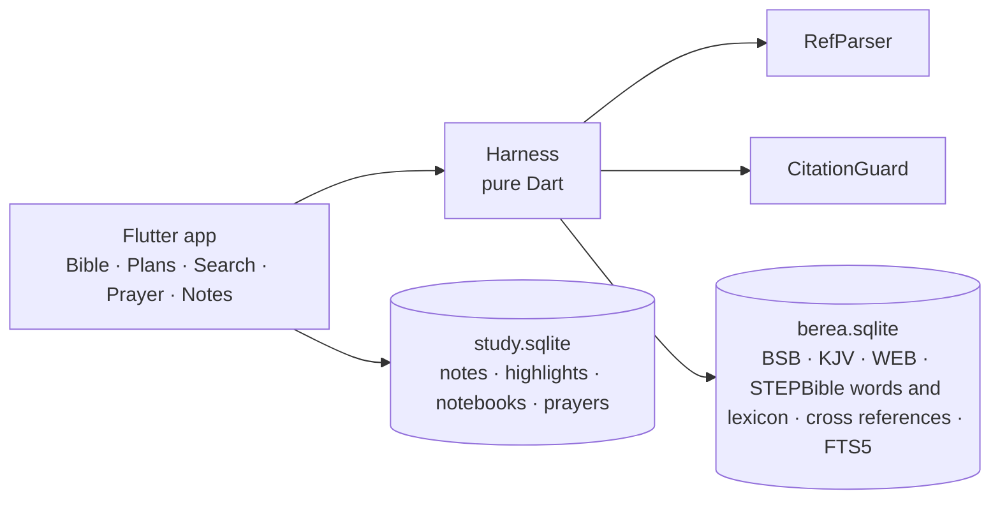

# Berea

A study Bible that works offline and shows Scripture first. The Bible, the Hebrew and Greek words
behind it, the commentaries you choose to add, and everything you write live in local databases on
your phone or computer. Nothing is sent anywhere, and nothing in the app writes text for you.

Named for Acts 17:11: the Bereans "received the message with great eagerness and examined the
Scriptures every day to see if these teachings were true."

Try it: [Android APK](https://github.com/CalvinMagezi/berea/releases/latest/download/berea-android-arm64.apk)
or [Mac app](https://github.com/CalvinMagezi/berea/releases/latest/download/berea-macos.zip)
(not notarized yet: the first time, open it from System Settings, Privacy & Security, Open Anyway).
How it works, in plain language: [calvinmagezi.github.io/berea](https://calvinmagezi.github.io/berea/).

## Principles

- **Zero data.** No account, no analytics, no crash reporting, no sync. The only network calls are
  downloads you start yourself: the optional lexicon pack and the commentary packs.
- **Fully offline.** Scripture, lexicon, cross references and your notes are on the device.
- **Scripture first.** Berea shows only Scripture, a counted fact, a named source, your own words,
  or interface wording that never says what a verse means. A selection says who made it and by
  what rule. Text a person did not write is labelled.
- **Open.** MIT licensed app; public domain and CC BY data.

## What it does

**Bible.** An offline reader with the Berean Standard Bible, the King James Version and the World
English Bible built in. Show a second translation beside or below the text. The BSB shows its
section headings with their parallel passages. Select verses to read their Hebrew or Greek words,
commentary or a study page, to write a note, or to highlight them. Import a translation you own
(CSV, USFM, OSIS, Zefania or a zip); it stays on your device.

**Search.** Type words or a reference. Results come in labelled groups, each in Bible order: the
exact words (confirmed against the verse text), the other forms of the word, verses with all your
words, verses with some of them, one group for every Hebrew or Greek word STEPBible's tagging
glosses with your word, and the headings the BSB's publisher printed. A word no verse has comes
back with the words one letter away. Each group says how its verses were found.

Search also looks past the verses. A word or short phrase lists the Hebrew and Greek words behind
it (found through STEPBible's glosses and the lexicon, most used first, each saying why it is
listed) and, from the commentary packs you have installed, the best comments of each work with the
words marked. A Strong's number (G26) or a spelling in English letters (hagios) finds the word
itself.

**Word study.** Long-press a word in the reader for the Hebrew or Greek word behind it (τέλειος,
teleios, G5046): its lexicon entry, how often it is used and in which books, how STEPBible glosses
it, and every verse that uses it, with the English words that render it marked. In the BSB the
word is exact: the BSB's own translation tables map each English word to its Hebrew or Greek. In
other translations Berea picks the word by its gloss and labels it a guess. Keep a word in a
notebook.

**Commentary.** Select verses and tap Commentary for what Matthew Henry, Jamieson, Fausset and
Brown, the Treasury of Scripture Knowledge, Aquinas's Catena Aurea and, if you add them, Calvin,
Clarke, Keil and Delitzsch, Barnes, Wesley and Spurgeon say on them, each with its author and
licence. The packs are optional public domain downloads.

**Plans.** Bible in a year, New Testament in 90 days, the Gospels in 30, Psalms and Proverbs in
60. Today's reading, and the first verse of it, sit on the Bible. A plan ticks chapters, not
days, and never counts a streak.

**Prayer.** A prayer list of your own: what you are praying for, the verse you stand on, and how each
prayer was answered. Berea writes no prayers; the words are yours.

**Notes and notebooks.** Notes, study pages and highlights in one searchable place. A notebook
gathers what you read on one passage or topic: Bible passages, commentary from the installed
packs, your notes, pasted text, PDFs and EPUB books. Berea reads each source on the device, splits
it into sections that remember where they came from (and the PDF page), and indexes them for
search. Search a notebook from its own screen. Export your notes to Markdown.

**Backup.** One encrypted file (AES-256-GCM, key from your passphrase) that you keep wherever you
like. Restore checks the file before it replaces anything. Backups from earlier versions still
restore: their notes come back labelled, and the chat they hold is not kept.

## How it works



The harness is a plain Dart package: the reference parser, the Bible database and its search, word
study, commentary, notebook text handling and the citation check. The app is Flutter. The Bible
database is built, not committed; `study.sqlite` holds everything you write.

Search reads the index's row ids instead of joining every hit back to the verse table: on a Galaxy
A32 that took queries from seconds to under a quarter of a second. The database records which
translations are stored in Bible order (`meta.bible_order`), and only those take the fast path.

## Data

| Dataset | Licence | Role |
|---------|---------|------|
| Berean Standard Bible | Public domain (CC0) | Default translation, the official text from [bereanbible.com](https://bereanbible.com) (`bsb.txt`), pinned by SHA-256 |
| BSB section headings | Public domain, with the BSB text | Section headings and parallel passage lines from the ebible.org BSB USFM (`engbsb_usfm.zip`), pinned by SHA-256; the verse text still comes from `bsb.txt` |
| King James Version | Public domain | Second translation |
| World English Bible | Public domain | Third translation, from the ebible.org USFM |
| STEPBible TAHOT and TAGNT | CC BY 4.0 | Every Hebrew and Greek word with transliteration, gloss, Strong's number and morphology |
| STEPBible TBESH and TBESG | CC BY 4.0 | Hebrew and Greek lexicon keyed by Strong's |
| OpenBible.info cross references | CC BY | Cross references ranked by votes |
| BSB translation tables | Public domain, with the BSB text ("Licensing is not required for any use", [berean.bible/licensing.htm](https://berean.bible/licensing.htm)) | Each English phrase of the BSB with its Strong's number (`bsb_tables.tsv`), pinned by SHA-256; word study uses it to find the exact Hebrew or Greek behind a pressed BSB word |

| STEPBible TFLSJ | CC BY 4.0 | Optional full Greek lexicon pack (about 9 MB), downloaded only on request from the [`lexicon-1` release](https://github.com/CalvinMagezi/berea/releases/tag/lexicon-1) and checked by SHA-256 |

Optional commentary packs, each downloaded only on request from the
[`commentary-1` release](https://github.com/CalvinMagezi/berea/releases/tag/commentary-1),
checked by SHA-256 and kept on the device. All come from CrossWire SWORD modules whose
`DistributionLicense` is `Public Domain`; the converter refuses any other licence.

| Pack (download) | Commentary | Licence note |
|-----------------|------------|--------------|
| Core (19 MB) | Matthew Henry's Concise Commentary (MHCC 2.0) | Public domain (Henry, 1706-1721) |
| | Jamieson, Fausset and Brown (JFB 3.0) | Public domain (1871) |
| | The Treasury of Scripture Knowledge (TSK 1.4) | Public domain (Torrey, 1880s) |
| | Catena Aurea on the Gospels (Catena 1.0.1) | Public domain (Aquinas, tr. Newman 1842); OSIS by Tom Lemmens, [lemtom/catena](https://github.com/lemtom/catena), CC0 |
| Matthew Henry, complete (24 MB) | MHC 2.2 | Public domain |
| Adam Clarke (15 MB) | Clarke 2.0 | Public domain (1810-1826) |
| John Calvin (25 MB) | CalvinCommentaries 1.1 | Public domain (Calvin Translation Society, 1844-1856) |
| Keil and Delitzsch, OT (17 MB) | KD 2.0 | Public domain (English translation 1866-1891) |
| Albert Barnes, NT (10 MB) | Barnes 1.1 | Public domain (1832-1851) |
| John Wesley (4 MB) | Wesley 1.1 | Public domain (1755-1765) |
| Spurgeon, The Treasury of David (8 MB) | TDavid 2.1 | Public domain (1869-1885) |

Not included: Robertson's Word Pictures and KingComments (non-commercial licences), anything
from Bible Hub or StudyLight, and John Gill (the HelloAO copy is marked Public Domain but its
provenance is undocumented, and it was not reachable when the packs were built). Patristic
excerpts from HistoricalChristianFaith/Commentaries-Database are mixed-licence and not yet
included; see `TECHDEBT.md`. The app lists every source and licence under Settings,
Commentaries, Licences and sources.

`packages/harness/bin/build_db.dart` downloads these and writes `assets/berea.sqlite` (about 81 MB,
29 MB compressed: 93k verses in three translations, 447k tagged words, 21k lexicon entries, 345k
cross references, and the word study concordance: `word_index` holds every use
of each base Strong's number and `gloss_index` the words STEP glosses with each English stem; `bsb_words` holds, for each BSB verse,
the Strong's number behind each of its words, aligned from the translation tables; `headings` holds
3,129 BSB section headings, each anchored to the verse it introduces, and the build fails if one
anchors to a verse the BSB does not have) and a
small `berea.sqlite.version` stamp. `bin/build_lexicon_pack.dart` builds
the optional lexicon pack, which is published with each release. None of these are committed.

The BSB is imported word for word from the official `bsb.txt`, and the build fails if its SHA-256 no
longer matches the pin in `build_db.dart`. When bereanbible.com publishes a revision, review the
new text, then update the pin. Each build also tries to write `.cache/bsb-diff.md`, a per-book
count and sample of verses that differ from the older scrollmapper copy that Berea 0.2 and earlier
used. The report is best effort: if that older copy cannot be fetched or fails its pin, the build
warns, writes no report and carries on.

`bin/build_commentary.dart` builds the commentary packs into `build/commentary/` with a
`manifest.json` of sizes, entry counts and SHA-256 pins. It reads the SWORD zCom files with a
small pure Dart reader (`lib/src/sword.dart`); libsword and pysword (both GPL) are not used at
build time or linked into the app. It needs `assets/berea.sqlite` for KJV versification, which
is what every SWORD module here is keyed to. Each CrossWire module zip is pinned by SHA-256, so a
republished module stops the build until it is reviewed, and a module whose `.conf` is not
Public Domain, KJV-keyed zCom is refused. Each pack is SQLite with
`entries(module, book, chapter, verse_start, verse_end, html_or_text)` holding plain display
text, an FTS5 index (porter unicode61), the module's attribution and a format stamp; the same
sources always give the same bytes. Book and chapter introductions are stored with chapter 0 or
verse 0; Matthew Henry's section-start keys are expanded to ranges, and Calvin's title pages and
prefaces (kept at Genesis 1:1, Psalm 1:1 and the first verse of other books) and the book
prefaces and chapter outlines that Keil and Delitzsch, Clarke and Barnes keep before their
first verse heading become introductions instead of verse comments. Spurgeon's Treasury of
David, which holds a whole psalm at its first verse, is split at its "Verse N" paragraphs. After a build, publish the `.gz` files
to the `commentary-1` release and copy the pins from `manifest.json` into `lib/commentary_packs.dart`.

Copyrighted translations such as the NIV and NLT are not bundled. Import one you own through
Settings from CSV (`Book,Chapter,Verse,Text`), USFM, OSIS, Zefania XML or a zip of those.
A normalised copy is kept under the app's support folder, re-imported after a database rebuild,
and never leaves the device.

User data (notes, highlights, saved studies, study pages, plan progress and notebooks) lives in
`study.sqlite` next to the Bible database. Notebook tables (`notebooks`, `notebook_sources` with
the normalised text, `notebook_chunks` with character offsets and PDF page numbers, and the
`notebook_chunks_fts` index kept in step by triggers) are added by a `user_version` migration,
and backups carry them from version 2 on.

PDF text is read with [PDFium](https://pdfium.googlesource.com/pdfium/) through
`pdfium_flutter` and `pdfium_dart` (MIT). PDFium is BSD 3-Clause and Apache 2.0; the binaries
also carry FreeType (FreeType License), libjpeg-turbo, OpenJPEG, Little CMS, libpng, zlib,
Abseil and ICU under their own permissive licences. Their full texts are kept in
`licenses/pdfium/` and shown on the app's licence page (Settings, Commentaries, Licences and
sources, Software licences). On iOS the pod fetches a PDFium build pinned by SHA-256. On
Android, Windows, Linux and macOS the package's build hook downloads `bblanchon/pdfium-binaries`
`chromium/7811` without a hash check unless the file is already in place, so run
`tool/pin_pdfium.sh <target>` (for example `mac-arm64`) after `flutter pub get` to put SHA-256
checked copies there first; CI and `tool/release.sh` do. On macOS both are built and land in the same
case-insensitive Frameworks folder, so which copy ships depends on build order (see
`TECHDEBT.md`). The app itself never downloads PDFium. EPUB is read with the harness's own zip reader and a
small XHTML to text step.

## Build and run

Requirements: Flutter 3.47+, Dart 3.13+. Xcode 27 for iOS and macOS, Android SDK for Android.

```bash
git clone https://github.com/CalvinMagezi/berea && cd berea
cd packages/harness && dart pub get && dart run bin/build_db.dart && cd ../..
flutter pub get
tool/pin_pdfium.sh mac-arm64   # SHA-256 checked PDFium for this Mac (see Data)
flutter run -d macos      # or -d <android device> / -d <ios simulator>
```

CI builds a Bible database with only the BSB text from the committed `site/data/bible` files
(`dart run bin/build_bsb_only_db.dart`), so the tests that need verse text run there. Tests that
need the words, lexicon or cross references skip unless `assets/berea.sqlite` is the full build.
`BEREA_DB` points the tests at another database file.

Tests and checks:

```bash
cd packages/harness && dart test && dart run bin/search_check.dart && cd ../.. && flutter test
bash tool/guard_no_model.sh && python3 tool/guard_strings.py
flutter test integration_test -d macos   # notebooks smoke test, real app, throwaway data folder
```

`bin/search_check.dart` cuts four words from a sample of BSB verses and checks the verse is found,
checks that 500 sampled words each return a result, and times the searches.

Release (builds the data, runs every check, builds Android and macOS, tags):

```bash
tool/release.sh 0.3.0
```

Android release signing reads `android/key.properties`; see `android/key.properties.example`.
Each app release also carries the APK as `berea-android-arm64.apk` and the Mac app as
`berea-macos.zip`, which links through `releases/latest/download/` always find, so publish app
releases with `--latest` and data releases (such as `lexicon-1` and `commentary-1`) with
`--latest=false`.

## Project layout

```
lib/
  main.dart            boots the app
  home_shell.dart      the five places, the phone bar with the raised Search button, the sidebar
  search_place_button.dart  the Berea mark in a Night circle
  reader_screen.dart   offline reader, parallel text, selection bar, chapter picker
  search_screen.dart   the Search place: verses, the words behind a word, and commentary, each on
                       its own isolate
  interlinear_sheet.dart  Hebrew and Greek words with lexicon entries
  word_study_screen.dart  a word's use, renderings and every verse
  commentary_sheet.dart, commentary_packs.dart  commentary, and the optional packs
  plans.dart, plans_screen.dart  reading plans
  prayer_*.dart        prayer list, points, plans
  notes_screen.dart, note_dialog.dart  notes
  notebooks_screen.dart, notebook_store.dart  notebooks, their sources, search and the source reader
  study_store.dart     local SQLite for everything the user writes, with its migrations
  provenance.dart      who wrote a note, a page or a source, and the label shown for it
  backup.dart          encrypted backup and restore
  pinned_download.dart streamed download checked against a published SHA-256
packages/harness/
  lib/src/             RefParser, BibleDb, search, CitationGuard, importers, word study,
                       commentary, notebook chunking, EPUB and HTML text
  bin/build_db.dart    builds assets/berea.sqlite from the datasets above
  bin/build_bsb_only_db.dart  builds the BSB-only database CI uses
  bin/search_check.dart  the search gate
  bin/build_lexicon_pack.dart, bin/build_commentary.dart  the optional packs
  bin/export_site.dart  writes the Bible data and parity fixture for the site's live check
tool/release.sh        local release
tool/guard_no_model.sh, tool/guard_strings.py  CI guards
tool/build_site.sh     builds the public site from site/ into build/site
site/                  the public page, deployed to GitHub Pages
docs/plans/            the plan this release follows, and its handover
```

## Platform notes

- **Android**: `minSdk 30`, arm64 only. The release APK is about 58 MB.
- **iOS**: deployment target 15.0, CocoaPods only. Swift Package Manager is turned off in
  `pubspec.yaml`: SPM debug builds embed an absolute host rpath, and when the checkout lives in a
  privacy-protected folder such as `~/Documents` the simulator's dyld hangs on it before `main`
  runs.
- **Windows and Linux**: built in CI.
- A small method channel keeps the data folder out of iCloud backups on iOS.

## Privacy

Berea makes no network request on its own. The optional lexicon and the commentary packs come from
github.com, only when you tap Download. There is no telemetry, no account, and no cloud copy of
anything you write. Backups are files you choose where to keep. Deleting the app deletes the data.

Android cloud backup and device transfer are turned off, and the iOS data folder is excluded from
iCloud backup. That is deliberate, and it has a cost: a lost or reset phone loses your notes unless
you made a Berea backup file. Make one now and then (Settings, Back up) and keep it somewhere you
trust.

An earlier version ran a language model on the device. It was removed: updating deletes the model
and voice files and the saved questions and answers, and keeps your notes.

Open items with reasons are tracked in `TECHDEBT.md`. Changes are in `CHANGELOG.md`.

## Contributing

Issues and pull requests are welcome. Keep the principles: no network calls beyond the optional
downloads, no accounts, no analytics, nothing in the app that writes text. Run the tests and the two
guards. Translations must be public domain or openly licensed to be bundled; anything else stays an
import.

## Licence

MIT. See `LICENSE`. Data licences are listed above; the STEPBible and OpenBible data require
attribution, which this README provides.
